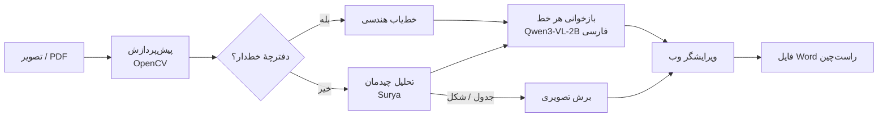

<div align="center">

# سامانهٔ بازخوانی برگه‌های دست‌نویس فارسی
### Persian Exam OCR: offline handwriting recognition → editable Word


-blue?style=flat-square)


**تصویر یا PDF برگه را بدهید، متن فارسی قابل‌ویرایش و فایل Word راست‌چین بگیرید؛ بدون اینترنت و بدون ارسال هیچ داده‌ای به بیرون از سرور.**

</div>

<div dir="rtl">

## چرا این سامانه؟

- **کاملاً آفلاین:** همهٔ مدل‌ها داخل ایمیج Docker هستند. برگهٔ دانشجو هرگز از سرور دانشگاه خارج نمی‌شود.
- **مخصوص دست‌خط فارسی:** تشخیص صفحه و خط با Surya، بازخوانی هر خط با مدل بینایی‌زبانی Qwen3-VL که برای فارسی تنظیم شده است.
- **برگه‌های خط‌دار و بدون خط:** دفترچه‌های خط‌دار با یک خط‌یاب هندسی، و برگه‌های آزاد با تحلیل چیدمان صفحه پردازش می‌شوند.
- **خروجی آمادهٔ استفاده:** فایل Word راست‌چین، به‌همراه ویرایشگر وب برای اصلاح متن پیش از دانلود.
- **API ساده:** چهار endpoint برای اتصال به سامانه‌های دانشگاه (LMS، سامانهٔ آموزش، یا هر سرویس داخلی).
- **قابل‌اندازه‌گیری:** اسکریپت ارزیابی همان مسیری را اجرا می‌کند که سرویس اجرا می‌کند؛ عددهای این صفحه از همین اسکریپت آمده‌اند.

## نحوهٔ کار



بازخوانی خط‌ها در یک فرایند جداگانه (worker) اجرا می‌شود، چون Surya و Qwen3-VL به نسخه‌های متفاوتی از کتابخانهٔ `transformers` نیاز دارند. ایمیج Docker هر دو محیط را آماده دارد.

## دقت اندازه‌گیری‌شده

ارزیابی روی **مجموعهٔ طلایی**: ۲۴۰ خط دست‌نویس از ۴ جزوهٔ مختلف که هیچ‌کدام در آموزش مدل استفاده نشده‌اند. متن مرجع هر خط دستی نوشته شده است. ۱۶۸ خط خوانا امتیازدهی شده‌اند؛ ۷۲ خط ناخوانا جداگانه بررسی شده‌اند.

| پیکربندی | دقت کاراکتری | دقت کلمه‌ای | بازهٔ اطمینان ۹۵٪ (کاراکتری) | سرعت |
|:--|:--:|:--:|:--:|:--:|
| **Qwen3-VL-2B فارسی (پیش‌فرض)** | **۶۳٫۹٪** | **۲۶٫۱٪** | ۵۹٫۷٪ تا ۶۸٫۰٪ | ~۱ ثانیه برای هر خط (Apple M2) |
| همان + تصحیح با LLM محلی (`qwen3:8b`) | ۶۳٫۹٪ | ۲۶٫۱٪ | ۵۹٫۷٪ تا ۶۷٫۹٪ | کندتر؛ بهبودی نداشت و پیش‌فرض خاموش است |

دقت به نوع دست‌خط بستگی زیادی دارد: روی جزوه‌های مرتب تا حدود ۶۹٪ دقت کاراکتری، و روی یک صفحهٔ یادداشت شخصی محاوره‌ای و ترکیبی فارسی/انگلیسی (`docs/images/test_sheet_ewc.jpg`) حدود ۳۰٪. جزئیات هر سند در [`eval/reports/`](eval/reports) آمده است.

> **توصیهٔ استفاده:** خروجی سامانه یک **پیش‌نویس** است که باید پیش از استفاده بازبینی شود. سامانه برای سرعت‌دادن به تایپ و بایگانی برگه‌ها مناسب است، نه برای نمره‌دهی خودکار بدون بازبینی انسانی.

ارزیابی را خودتان تکرار کنید:

```bash
HF_HOME=models/hf HF_HUB_OFFLINE=1 python scripts/eval_release.py \
    --engine qwen3vl-fa --label my_run --data-root /path/to/gold
```

## راه‌اندازی سریع (Docker، پیشنهادی)

**پیش‌نیاز:** یک سرور لینوکسی x86-64 با Docker، حداقل **۱۶ گیگابایت RAM** (مدل روی CPU حدود ۹ گیگابایت حافظه می‌گیرد) و ۲۰ گیگابایت فضای خالی دیسک. GPU لازم نیست؛ با GPU سرعت چند برابر می‌شود.

### الف) با فایل ایمیج آماده (بدون نیاز به اینترنت)

```bash
sha256sum -c persian-exam-ocr-1.0.tar.gz.sha256     # بررسی سالم بودن فایل
docker load -i persian-exam-ocr-1.0.tar.gz
mkdir -p outputs logs && sudo chown 1000:1000 outputs logs
docker compose up -d                                  # یا: docker run -d -p 8000:8000 persian-exam-ocr:1.0
```

سپس `http://<آدرس-سرور>:8000` را باز کنید. در اولین اجرا یک آزمون خودکار (self-test) وجود همهٔ مدل‌ها و اجزا را بررسی می‌کند و اگر چیزی کم باشد، سرویس بالا نمی‌آید.

### ب) ساخت ایمیج از روی کد

```bash
git clone https://github.com/alireza-taheriF/persian-exam-ocr.git && cd persian-exam-ocr
./scripts/prepare_models.sh                           # دانلود یک‌بارهٔ مدل‌ها (~۴٫۸ گیگابایت)
docker buildx build --platform linux/amd64 -t persian-exam-ocr:1.0 .
```

برای سرورهای دارای GPU انویدیا، هنگام build این گزینه را اضافه کنید: `--build-arg TORCH_INDEX=https://download.pytorch.org/whl/cu126`. سپس بخش `deploy` را در `docker-compose.yml` فعال کنید. اگر Docker Hub یا PyPI در دسترس نیست، از mirror استفاده کنید (نمونه‌ها در ابتدای `Dockerfile`).

### ج) اجرا بدون Docker (برای توسعه)

```bash
python3.12 -m venv .venv-app && .venv-app/bin/pip install torch torchvision -r requirements-app.txt
python3.12 -m venv .venv-ocr && .venv-ocr/bin/pip install torch torchvision -r requirements-ocr.txt
./scripts/prepare_models.sh
OCR_PYTHON=.venv-ocr/bin/python HF_HUB_OFFLINE=1 .venv-app/bin/uvicorn main:app --port 8000
```

## اتصال به سامانه‌های دانشگاه (REST API)

| روش | مسیر | کاربرد |
|:--|:--|:--|
| `GET` | `/health` | وضعیت سرویس و موتور OCR (برای مانیتورینگ) |
| `POST` | `/upload` | ارسال فایل (`jpg`، `png`، `tif`، `pdf`) و دریافت متن، به‌صورت همگام |
| `POST` | `/update/{job_id}` | ذخیرهٔ متن ویرایش‌شده و ساخت دوبارهٔ فایل Word |
| `GET` | `/download/{job_id}` | دانلود فایل Word |
| `GET` | `/status/{job_id}` | وضعیت یک درخواست |

```bash
# بازخوانی یک برگه
curl -F "file=@sheet.jpg" http://ocr.university.local:8000/upload
# → {"job_id": "…", "status": "done", "full_text": "…", "blocks": […], "output_file": "outputs/result_….docx"}

# دریافت فایل Word
curl -o result.docx http://ocr.university.local:8000/download/<job_id>
```

مستندات تعاملی API (Swagger) در مسیر `/docs` در دسترس است.

**نکته‌های استقرار:**

- **احراز هویت:** سرویس خودش احراز هویت ندارد. آن را فقط روی شبکهٔ داخلی، یا پشت یک reverse proxy مثل nginx با SSO یا ورود دانشگاه قرار دهید.
- **حجم فایل:** در nginx مقدار `client_max_body_size 30m` و `proxy_read_timeout 600s` را تنظیم کنید. پردازش هر صفحه روی CPU حدود ۱ تا ۳ دقیقه طول می‌کشد.
- **حریم خصوصی:** با `OCR_ALLOW_REMOTE=0` (پیش‌فرض) هیچ تصویری از سرور خارج نمی‌شود. فایل‌های آپلودشده در `uploads/` داخل کانتینر و خروجی‌ها در `outputs/` می‌مانند؛ سیاست حذف دوره‌ای آن‌ها را مشخص کنید.
- **همزمانی:** نسخهٔ فعلی درخواست‌ها را یکی‌یکی پردازش می‌کند و وضعیت کارها را در حافظه نگه می‌دارد. برای بار زیاد، چند نمونه پشت load balancer اجرا کنید.

## تنظیمات

همهٔ تنظیمات اختیاری‌اند. نمونهٔ کامل را در [`.env.example`](.env.example) ببینید.

| متغیر | پیش‌فرض | توضیح |
|:--|:--|:--|
| `OCR_ENGINE` | `qwen3vl-fa` | موتور بازخوانی خط |
| `OCR_ALLOW_REMOTE` | `0` | با `1`، تصاویر به API خارجی تعریف‌شده در `VLM_API_BASE` فرستاده می‌شوند |
| `OCR_POST_CORRECT` | `0` | تصحیح املایی با Ollama محلی (در ارزیابی، بهبودی نداشت) |
| `OCR_MAX_PIXELS` | `1000000` | برش‌های بزرگ‌تر پیش از بازخوانی کوچک می‌شوند |
| `HF_HOME` | `models/hf` | محل مدل‌ها |

## ساختار پروژه

```text
main.py                 سرویس وب (FastAPI) و مسیرهای API
static/index.html       رابط کاربری فارسی: آپلود، ویرایش، دانلود
pipeline/               پیش‌پردازش، چیدمان، خط‌یاب، OCR، خروجی Word
htr_eval/               موتورهای بازخوانی خط و worker جداگانه
training/finetune/      اسکریپت تنظیم دقیق (QLoRA) برای پژوهش‌های بعدی
scripts/                آماده‌سازی مدل‌ها، ارزیابی، self-test کانتینر
eval/reports/           گزارش‌های ارزیابی و پیش‌بینی‌های هر خط
```

**توسعه‌دهنده:** علیرضا طاهری فخر — [github.com/alireza-taheriF](https://github.com/alireza-taheriF)

</div>

---

<details>
<summary><b>English summary</b></summary>

**Persian Exam OCR** turns photos or PDFs of handwritten Persian exam sheets and notes into editable text and a right-to-left Word document, fully offline. Pages are preprocessed with OpenCV. Ruled notebook pages go through a geometric line finder, and free-form pages through Surya layout analysis. Each line is then read by a Persian fine-tune of Qwen3-VL-2B, and a FastAPI web app lets a reviewer correct the text before export.

**Measured accuracy** (held-out gold set: 240 lines from 4 documents, 168 legible lines scored): 63.9% character accuracy (95% CI 59.7–68.0%) and 26.1% word accuracy, at about 1 s per line on an Apple M2. An optional local LLM post-correction gave no measurable gain. Treat the output as a draft for human review.

**Deploy:** `docker load -i persian-exam-ocr-1.0.tar.gz && docker compose up -d`. The image contains all model weights and runs with `HF_HUB_OFFLINE=1`, and a pre-flight self-test refuses to start if anything is missing. No GPU is required.

**API:** `POST /upload`, `POST /update/{job_id}`, `GET /download/{job_id}`, `GET /status/{job_id}`, `GET /health`; Swagger at `/docs`.

</details>
